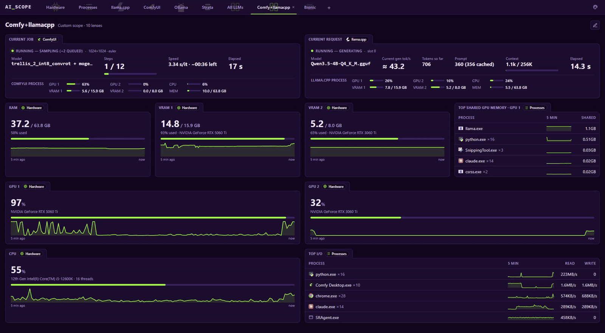

<p align="center"></p>

<h3 align="center">Monitor your on-prem AI environment with scopes</h3>

<p align="center">Ollama · llama.cpp · Strata and more · Windows, macOS, Linux · free and open source</p>

<p align="center">
  <a href="https://github.com/quantiqueue/ai_scope/releases/latest"></a>
  <a href="https://github.com/quantiqueue/ai_scope/actions/workflows/ci.yml"></a>
  <a href="LICENSE"></a>
  <a href="https://buymeacoffee.com/quantiqueue"></a>
</p>

<p align="center"></p>

<p align="center"><sub>AI_SCOPE monitoring ComfyUI and llama.cpp</sub></p>

AI_SCOPE is a dashboard for the AI apps on your own PC. It shows what your local AI engines are doing right now: tokens per second, image steps, which model is loaded, and how much of your GPU and VRAM it takes. It also keeps a history of every request and run. It runs in your browser, and your data stays on your PC.

- **Live and after the fact.** While something runs you see its speed, tokens and progress. Afterwards, every request and run is in a table with its speed and peak load.
- **Each app's own hardware use.** GPU %, VRAM per graphics card, CPU and RAM for the app's own process, next to whole-PC **Hardware** and **Processes** scopes.
- **Your own views.** Custom scopes put lenses from any app side by side, and every page can be rearranged.
- **Light and private.** One install line, no admin rights, no account, no cloud, no telemetry. Settings and history are plain JSON files in `~/.ai_scope` ([where the data comes from](manual/DATA_SOURCE.md)).

## Install

**Windows** (PowerShell):

```powershell
irm https://github.com/quantiqueue/ai_scope/releases/latest/download/install.ps1 | iex
```

**macOS / Linux**:

```sh
curl -fsSL https://github.com/quantiqueue/ai_scope/releases/latest/download/install.sh | sh
```

That's it: no admin rights, nothing to install first. The installer downloads the latest release, uses your Node.js if you have version 18 or newer (otherwise it downloads a private copy just for AI_SCOPE, checked against the official checksums), and adds the `ai_scope` command. [Go here](manual/RUNNING_AI_SCOPE.md) to learn more about running AI_SCOPE.

## Scopes and lenses

Every tab is a **scope**. Each card or table on a scope is a **lens** (e.g. Strata's *Current request*, Ollama's *Requests*, a *GPU* tile). Every lens has a header tab with its title. See [How to scope](manual/HOW_TO_SCOPE.md) for using scopes, editing pages and lens settings, and building your own custom scopes, [Configuring scopes](manual/CONFIGURING_SCOPES.md) for scope settings, and [Configuring Ollama](manual/CONFIGURING_OLLAMA.md) for Ollama request stats. Everything else is in the [manual](manual/README.md).

### Supported scopes

| Scope | What it shows |
|---|---|
| **Hardware** (built in) | CPU, RAM, a GPU + VRAM tile per graphics card and a Disk tile per physical disk (active time, read / write speed), with 5-minute sparklines; GPU temperature and power draw on NVIDIA cards |
| **Processes** (built in) | Your AI apps' own VRAM, GPU, CPU and RAM (AI processes), and the top 5 processes by CPU, RAM, I/O (read / write), and per graphics card GPU, VRAM and shared GPU memory, each with a 5-minute line per process |
| **Bionic** | LM Studio's Bionic: current request (live state, tok/s), loaded models, request history, installed models with VRAM fit |
| **Ollama** | Current request (live state, tok/s, thinking tokens), loaded models (GPU/CPU split), request history, installed models with VRAM fit |
| **ComfyUI** | Current job (step progress, speed, time left), run history with thumbnails, installed models (filter by type) |
| **Strata** | Current request (reading / thinking / answering, tok/s, prompt and context fill), loaded model (experts in VRAM, speculation), request history (reused prompt tokens, hit rate), installed models with Strata's own fit verdict |
| **llama.cpp** | A llama.cpp server (`llama serve` or `llama-server`): current request (tok/s, tokens, prompt, context), loaded models (quantization, size, context, slots, VRAM per card), installed models (a router's models folder), slots (busy / idle, context used), request history (estimated from the server's slots) |
| **Custom** | A custom scope is your own page made of lenses from any installed scope, e.g. ComfyUI's current job next to Strata's current request and your GPU tiles. |

## Troubleshooting

- **Page doesn't load from another device**: start with `--host 0.0.0.0`, and allow the port through the firewall (on Windows, allow Node.js when the firewall asks, or add an inbound rule for TCP 9000).
- **"Port 9000 is already in use"**: AI_SCOPE (or something else) is already running there. Close it (`ai_scope --stop` if it runs in the background), or use `--port 9100`.
- **A scope says offline**: start that app (for Bionic, also start its local server on the Local Server screen; for Strata, the Strata desktop app; for llama.cpp, `llama serve -m <model.gguf>` or `llama-server`).
- **No Ollama requests listed**: the app isn't using the relay on port 11435 (see [Configuring Ollama](manual/CONFIGURING_OLLAMA.md)). In PowerShell, `set` doesn't work; use `$env:OLLAMA_HOST=...`.
- **No GPU temperature or power**: only NVIDIA cards report them.
- **Fewer lenses on a Mac or Linux PC**: lenses a system can't fill are left out, e.g. per-process GPU numbers on a Mac or on Linux without an NVIDIA card. See [How to scope](manual/HOW_TO_SCOPE.md#processes-scope).
- **Can't rename or move the AI_SCOPE folder**: stop AI_SCOPE first (`ai_scope --stop`, or close its console window / end *Node.js* in Task Manager).

## Support AI_SCOPE

AI_SCOPE is free and [MIT-licensed](LICENSE). I build it, test it and pay for the resources myself, and I keep testing it on a variety of hardware and operating systems to make sure it works on yours. A coffee helps me add more features, fixes and support.

<a href="https://buymeacoffee.com/quantiqueue"></a>

Contact me via [GitHub](https://github.com/quantiqueue).

<sub>The app logos shown in AI_SCOPE (and the fallback copies in `assets/logos`) belong to their projects and are used only to show which app a scope watches. AI_SCOPE is not affiliated with or endorsed by these projects.</sub>
