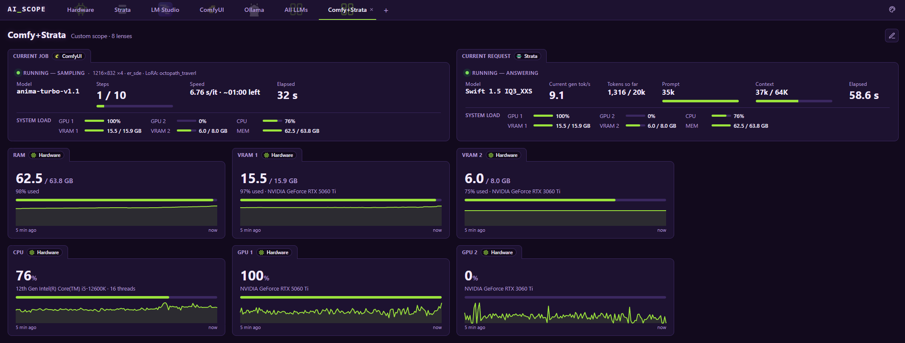

[](https://github.com/quantiqueue/ai_scope/releases/latest) [](https://github.com/quantiqueue/ai_scope/actions/workflows/ci.yml) [](LICENSE)

A locally-run orchestration kit for monitoring your on-prem AI environment with scopes.



<p align="center"><em>AI_SCOPE Running a custom scope for ComfyUI and Strata</em></p>

## Install

**Windows** (PowerShell):

```powershell
irm https://github.com/quantiqueue/ai_scope/releases/latest/download/install.ps1 | iex
```

**macOS / Linux**:

```sh
curl -fsSL https://github.com/quantiqueue/ai_scope/releases/latest/download/install.sh | sh
```

That's it: no admin rights, nothing to install first. The installer downloads the latest release, uses your Node.js if you have version 18 or newer (otherwise it downloads a private copy just for AI_SCOPE, checked against the official checksums), and adds the `ai_scope` command. [Go here](RUNNING_AI_SCOPE.md) to learn more about running AI_SCOPE.

## Scopes and lenses

Every tab is a **scope**. Each card or table on a scope is a **lens** (e.g. Strata's *Current request*, Ollama's *Requests*, a *GPU* tile). Every lens has a header tab with its title. See [How to scope](HOW_TO_SCOPE.md) for using scopes and building your own custom scopes, and [Configuring scopes](CONFIGURING_SCOPES.md) for scope settings and Ollama request stats.

### Supported scopes

| Scope | What it shows |
|---|---|
| **Hardware** (built in) | CPU, RAM, and a GPU + VRAM tile per graphics card, with 5-minute sparklines; GPU temperature and power draw on NVIDIA cards |
| **Processes** (built in, Windows) | Your AI apps' own VRAM, GPU, CPU and RAM (AI processes), and the top 5 processes by CPU, RAM, and per graphics card GPU, VRAM and shared GPU memory, each with a 5-minute line per process |
| **Bionic** | LM Studio's Bionic: current request (live state, tok/s), loaded models, request history, installed models with VRAM fit |
| **Ollama** | Current request (live state, tok/s, thinking tokens), loaded models (GPU/CPU split), request history, installed models with VRAM fit |
| **ComfyUI** | Current job (step progress, speed, time left), run history with thumbnails, installed models (filter by type) |
| **Strata** | Current request (reading / thinking / answering, tok/s, prompt and context fill), loaded model (experts in VRAM, speculation), request history (reused prompt tokens, hit rate), installed models with Strata's own fit verdict |
| **llama.cpp** | A llama.cpp server (`llama serve` or `llama-server`): current request (tok/s, tokens, prompt, context), loaded models (quantization, size, context, slots, VRAM per card), installed models (a router's models folder), slots (busy / idle, context used), request history (estimated from the server's slots) |
| **Custom** | A custom scope is your own page made of lenses from any installed scope, e.g. ComfyUI's current job next to Strata's current request and your GPU tiles. |

## Troubleshooting

- **Page doesn't load from another device**: start with `--host 0.0.0.0`, and allow the port through the firewall (on Windows, allow Node.js when the firewall asks, or add an inbound rule for TCP 9000).
- **"Port 9000 is already in use"**: AI_SCOPE (or something else) is already running there. Close it (`ai_scope --stop` if it runs in the background), or use `--port 9100`.
- **A scope says offline**: start that app (for Bionic, also start its local server on the Local Server screen; for Strata, the Strata desktop app; for llama.cpp, `llama serve -m <model.gguf>` or `llama-server`).
- **No Ollama requests listed**: the app isn't using the relay on port 11435 (see [Configuring scopes](CONFIGURING_SCOPES.md#ollama-request-stats-relay-on-port-11435)). In PowerShell, `set` doesn't work; use `$env:OLLAMA_HOST=...`.
- **No GPU temperature or power**: only NVIDIA cards report them.
- **Can't rename or move the AI_SCOPE folder**: stop AI_SCOPE first (`ai_scope --stop`, or close its console window / end *Node.js* in Task Manager).

## License

[MIT](LICENSE)

The app logos shown in AI_SCOPE (and the fallback copies in `assets/logos`) belong to their projects and are used only to show which app a scope watches. AI_SCOPE is not affiliated with or endorsed by these projects.
