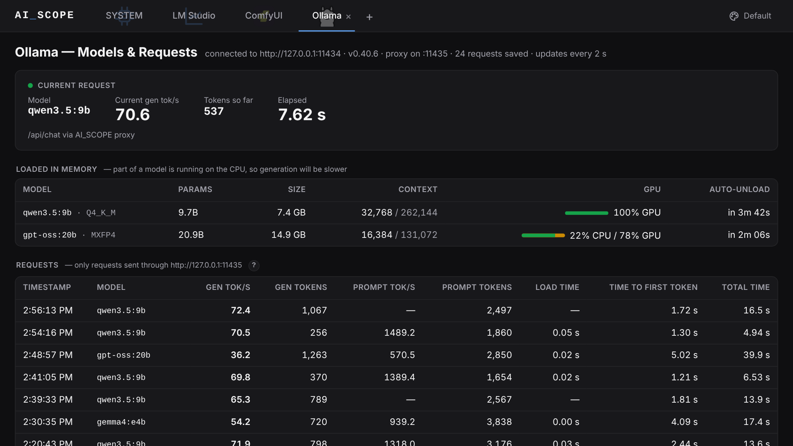

[](https://github.com/quantiqueue/ai_scope/releases/latest) [](https://github.com/quantiqueue/ai_scope/actions/workflows/ci.yml) [](LICENSE)

A local web dashboard for keeping an eye on the AI tools on your computer by using scopes for **LM Studio**, **Ollama**, **ComfyUI** and more.



*Example Ollama Scope Showing Live Metrics*

## Install

**Windows** (PowerShell):

```powershell
irm https://github.com/quantiqueue/ai_scope/releases/latest/download/install.ps1 | iex
```

**macOS / Linux**:

```sh
curl -fsSL https://github.com/quantiqueue/ai_scope/releases/latest/download/install.sh | sh
```

That's it: no admin rights, nothing to install first. The installer downloads the latest release, uses your Node.js if you have version 18 or newer (otherwise it downloads a private copy just for AI_SCOPE, checked against the official checksums), and adds the `ai-scope` command. On Windows it also adds **AI_SCOPE** to the Start Menu and starts it right away.

Then open **http://localhost:9000** (`ai-scope --open` does it for you) and install the scopes you use from the Scopes page (**+**).

- **Update**: run the same install line again. Your settings and history are kept.
- **Uninstall**: `ai-scope --uninstall` (asks whether to keep your settings and history).
- **Start at login**: `ai-scope --install-startup`, or install with `$env:AI_SCOPE_STARTUP="1"` (Windows) / `curl ... | AI_SCOPE_STARTUP=1 sh`.
- **Want to read the script first?** Download [install.ps1](https://github.com/quantiqueue/ai_scope/releases/latest/download/install.ps1) or [install.sh](https://github.com/quantiqueue/ai_scope/releases/latest/download/install.sh), look it over, then run it.

| Installed to | Windows | macOS / Linux |
|---|---|---|
| App (+ private Node.js if needed) | `%LOCALAPPDATA%\ai-scope` | `~/.local/share/ai-scope` |
| `ai-scope` command | `%LOCALAPPDATA%\ai-scope\bin` (added to your PATH) | `~/.local/bin/ai-scope` |
| Settings and history | `%USERPROFILE%\.ai_scope` | `~/.ai_scope` |

### Options

    ai-scope --open               # open the dashboard in your browser
    ai-scope --port 9100          # use another port (default 9000)
    ai-scope --host 0.0.0.0       # also reachable from phones/PCs on your network
    ai-scope --data-dir D:\aiscope  # keep settings and history somewhere else
    ai-scope --install-startup    # start automatically when you log in
    ai-scope --uninstall-startup  # undo that
    ai-scope --help

Keep the AI_SCOPE window open while you use it; close it (or **Ctrl+C**) to stop.

By default only this computer can open the dashboard (`127.0.0.1`). With `--host 0.0.0.0` the window also prints the network address(es) to use from other devices.

`--install-startup` remembers the other flags you pass with it (e.g. `ai-scope --host 0.0.0.0 --install-startup`). On Windows it adds `ai-scope.cmd` to your Startup folder (opens a minimized *AI_SCOPE* window; close it to stop). On macOS it adds a LaunchAgent, on Linux a desktop autostart entry.

## Supported Scopes

| Scope | What it shows |
|---|---|
| **Hardware** | CPU, RAM, GPU and VRAM usage with 5-minute sparklines |
| **LM Studio** | Current request (live tok/s), loaded models, request history, installed models |
| **Ollama** | Current request, loaded models (GPU/CPU split), request history, installed models |
| **ComfyUI** | Current workflow progress, run history with thumbnails, installed models |

- Click **+** to open the Scopes page. Only **Hardware** is installed at first; click **Install** on a scope, check its settings (e.g. the LM Studio folder) and its tab is added. **Remove** takes the tab away and stops that scope; **Settings** changes an installed scope's settings. Click an installed scope to reopen a closed tab.
- Scopes are listed in **`scopes.json`** (name, description, icon, the server modules that collect its data, and the settings asked at install). Installed scopes and their settings are saved in `~/.ai_scope/installed.json`.
- Drag tabs to reorder them; close a tab with its **×**. Each browser remembers its own tabs and order.
- Model and publisher names link to their Hugging Face / Ollama / LM Studio pages (opens a new tab).
- Tables page by 15; ComfyUI's installed models can be filtered by type.

## Where the data comes from

| App | Source | Notes |
|---|---|---|
| LM Studio | API at `http://127.0.0.1:1235` (or 1234) + its server logs in `%USERPROFILE%\.lmstudio\apps\bionic\server-logs` | The LM Studio server must be running (Developer tab). Every app using LM Studio is recorded. LM Studio doesn't report GPU offload. |
| Ollama | API at `http://127.0.0.1:11434` | Request stats only for apps that go through the AI_SCOPE relay — see below. |
| ComfyUI | API at `http://127.0.0.1:8188` (or 8000) | Runs are saved to `~/.ai_scope/comfy-runs.jsonl`. |
| Hardware | Node `os` + `nvidia-smi` (or Windows GPU counters) | |

### Ollama request stats (relay on port 11435)

Ollama only reports token speed and timings to the app that sent the request, so AI_SCOPE runs a small relay at **`http://127.0.0.1:11435`** that forwards everything to Ollama and records the stats on the way.
Apps that talk to Ollama directly (11434) still work normally, they just don't appear in the Requests table.

| Where | How |
|---|---|
| PowerShell | `$env:OLLAMA_HOST="127.0.0.1:11435"` then `ollama run qwen3.5:4b` |
| cmd | `set OLLAMA_HOST=127.0.0.1:11435` then `ollama run qwen3.5:4b` |
| Mac / Linux terminal | `export OLLAMA_HOST=127.0.0.1:11435` |
| VS Code (Continue, Cline, Copilot…) | In the extension's Ollama settings, change the address from `http://localhost:11434` to `http://127.0.0.1:11435` |
| Other apps / scripts | Ollama URL `http://127.0.0.1:11435` (or `.../v1` for OpenAI-style clients) |

The terminal settings apply to that window only.

## Scope settings (asked when installing)

| Scope | Settings |
|---|---|
| LM Studio | LM Studio folder (default `%USERPROFILE%\.lmstudio`), server URL (empty = try `:1234`, then `:1235`), models folder (empty = inside the LM Studio folder) |
| ComfyUI | URL (empty = try `:8188`, then `:8000`) |
| Ollama | URL (default `http://127.0.0.1:11434`), relay port (default `11435`) |

## Troubleshooting

- **Page doesn't load from another device**: start with `--host 0.0.0.0`, and allow the port through the firewall (on Windows, allow Node.js when the firewall asks, or add an inbound rule for TCP 9000).
- **"Port 9000 is already in use"**: AI_SCOPE (or something else) is already running there. Close it, or use `--port 9100`.
- **A scope says offline**: start that app (for LM Studio, also start its server in the Developer tab).
- **No Ollama requests listed**: the app isn't using the relay on port 11435 (see above). In PowerShell, `set` doesn't work; use `$env:OLLAMA_HOST=...`.
- **Can't rename or move this folder**: close the AI_SCOPE console window completely (or end *Node.js* in Task Manager) first.

## License

[MIT](LICENSE)
